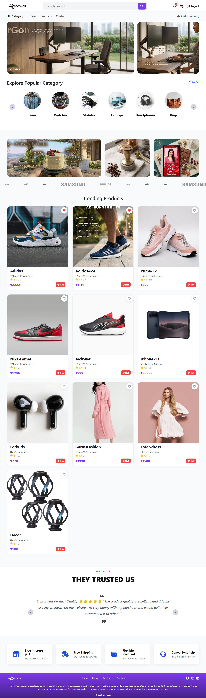
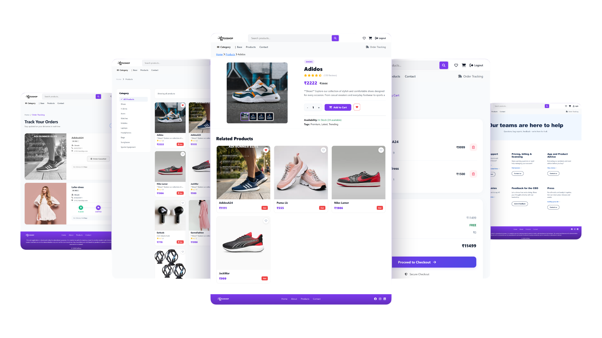

<h1 align="center">𝐅𝐔𝐋𝐋-𝐒𝐓𝐀𝐂𝐊 𝐄𝐂𝐎𝐌𝐌𝐄𝐑𝐂𝐄 𝐏𝐋𝐀𝐓𝐅𝐎𝐑𝐌</h1>

<p align="center">
  
</p>

<p align="center"><b>Full-Stack-Ecommerce-Platform built with:--</b></p>

<p align="center">
  
  
  
  
</p>

<p align="center">
  <a href="https://github.com/DineshGopi-G/Full-Stack-Ecommerce-Platform/stargazers">
    
  </a>
  <a href="https://github.com/DineshGopi-G/Full-Stack-Ecommerce-Platform/network/members">
    
  </a>
  
</p>

<p align="center">
  
</p>

<p align="center">
  
</p>

<br>

---

<h2 align="center">𝐒𝐓𝐄𝐏𝐒 𝐓𝐎 𝐑𝐔𝐍 𝐓𝐇𝐄 𝐏𝐑𝐎𝐉𝐄𝐂𝐓</h2>

<p align="center"><i>Follow the instructions below to set up and run GoShop on your local machine (Windows, PowerShell).</i></p>

---

1. Clone the repo

   ```
   git clone https://github.com/DineshGopi-G/Full-Stack-Ecommerce-Platform.git
   ```

2. Change your directory to the cloned repo

   ```
   cd Full-Stack-Ecommerce-Platform
   ```

3. Create a Python 3.12 virtual environment

   ```
   py -3.12 -m venv .venv
   ```

4. Activate the virtual environment

   ```
   .\.venv\Scripts\Activate
   ```

5. Install the required libraries

   ```
   pip install -r requirements.txt
   ```

6. Apply the database migrations

   ```
   python manage.py migrate
   ```

7. Run the Django development server

   ```
   python manage.py runserver
   ```

8. Open the website in your browser

   ```
   http://127.0.0.1:8000/
   ```

<br>

<table align="center">
  <tr>
    <td align="center">
      <br>
      <h3>⭐ 𝐒𝐔𝐏𝐏𝐎𝐑𝐓 𝐓𝐇𝐄 𝐏𝐑𝐎𝐉𝐄𝐂𝐓 ⭐</h3>
      <b>Note:</b> If you like this project, then just <b>follow me</b> 👍 and <b>star</b> ✨ this repository!
      <br><br>
      <a href="https://github.com/DineshGopi-G">
        
      </a>
      &nbsp;&nbsp;
      <a href="https://github.com/DineshGopi-G/Full-Stack-Ecommerce-Platform">
        
      </a>
      <br><br>
      <i>Your support keeps this project growing — thank you! 💜</i>
      <br><br>
    </td>
  </tr>
</table>
